# Original dashboard and saved worksheet previews

## Final report dashboard

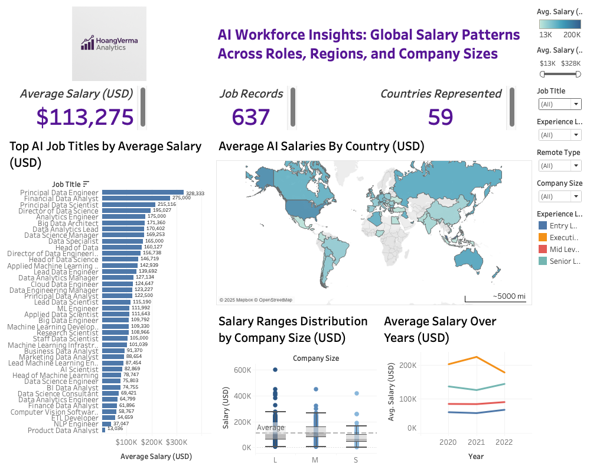

This larger image is the unchanged dashboard figure from the final report. It provides the overall context for the cached previews below. Original crowded labels, truncated legends and the axis typo are preserved as historical evidence.

## Workbook previews

The final TWB embeds eleven saved previews: one dashboard and ten worksheets. Some are small or cropped viewports; they are not fresh complete figure exports. All ten worksheets are shown below, including the three not placed on the final dashboard. See the [manifest](technical/figure_manifest.json) for original names, dimensions and hashes.

### Saved dashboard thumbnail

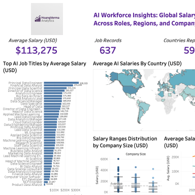

This is a cropped cached dashboard preview. Use the larger final-report image above for the overall dashboard.

### Bar Chart - Job Title Salaries

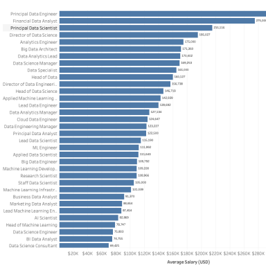

Placed on the final dashboard. Mean Salary (USD) by the project-remapped job-title field. Small group counts, saved filters and remapping affect comparisons.

### Bar Chart - Salary by Job Title

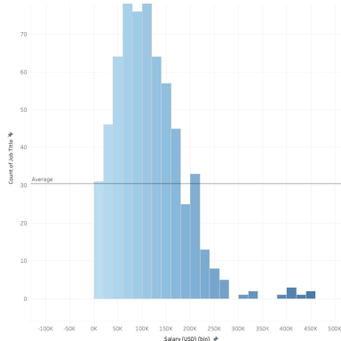

Additional worksheet, not placed on the final dashboard. Despite the internal name, this view is a salary distribution: 20,000-USD bins on the x-axis and job-record counts on the y-axis.

### Bar Chart - Salary by Remote Ratio

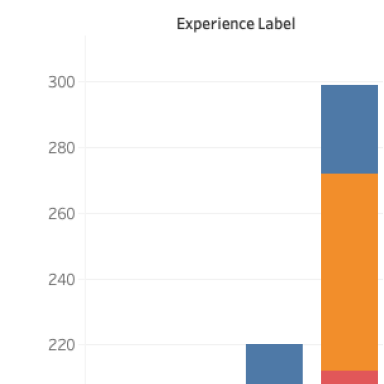

Additional worksheet, not placed on the final dashboard. Despite the internal name, this view binds Experience Label on the x-axis and job-record counts on the y-axis. The saved preview is cropped.

### Box Plot - Salary by Experience Level

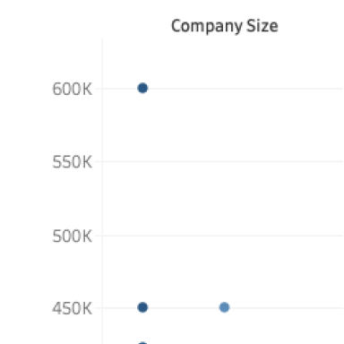

Placed on the final dashboard. The actual grouping is Company Size, not experience level. The saved preview shows only part of the original view; consult the full dashboard above.

### KPI – Average Salary

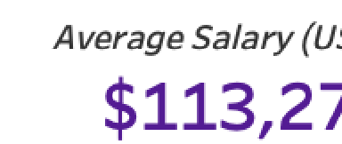

Placed on the final dashboard. Mean recorded Salary (USD). The cached viewport truncates part of the label; the larger report image shows the saved $113,275 value.

### KPI – Countries

Placed on the final dashboard. COUNTD(Employee Country), not company locations. The larger report image shows 59 employee-residence codes.

### KPI – Job Records

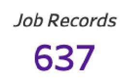

Placed on the final dashboard. COUNT of the job-title field, not a count of unique people or active job openings. The saved dashboard shows 637 records.

### Line - Salary Trend Over Time

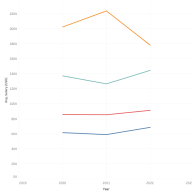

Placed on the final dashboard. Mean recorded salary by work year and saved experience grouping. Historical 2020-2022 sample composition varies, so lines do not establish like-for-like wage growth.

### Map - Salary by Company Location

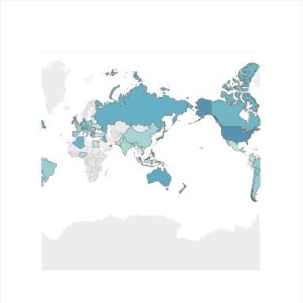

Placed on the final dashboard. The actual location field is Employee Country, derived from employee residence. Original map-provider attribution remains visible.

### Pie Chart - Remote vs On-Site Work

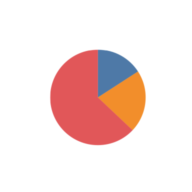

Additional worksheet, not placed on the final dashboard. Additional saved work-arrangement view. It is a descriptive record distribution, not a population estimate or an effect of remote work.
