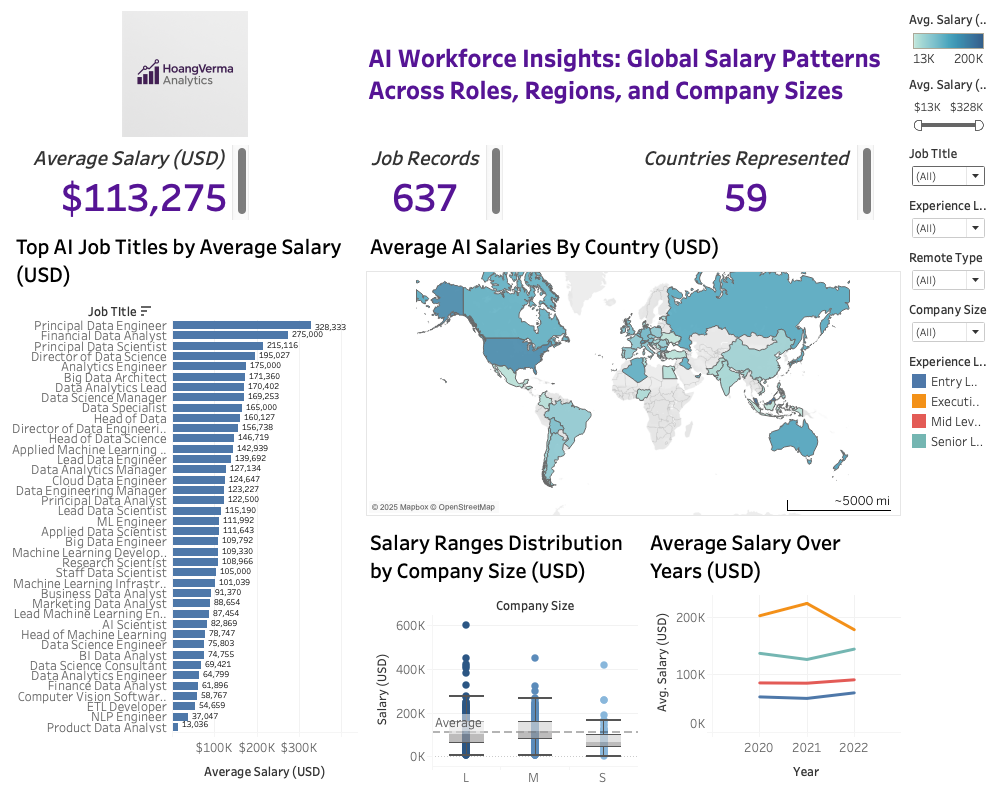

# Data and AI Workforce Salary Dashboard in Tableau

A **business intelligence and salary-analysis case study** that uses Tableau
and Tableau Prep to compare sampled pay by job role, experience, work arrangement,
company size and employee geography. The workflow turns a 637-record CSV into
categorical fields, analytical views and a dashboard with three KPI indicators.

Collaborative academic project by **Denny Hoang and Vansh Verma**, completed in
2025 using a historical **2020-2022 salary snapshot**. The original project was
called AI Workforce Insights; the source also includes broader data roles.

**[View all visuals](FIGURE_GALLERY.md) · [Explore the Tableau source](tableau/original_workbook.twb) · [Read the Prep calculations](prep/calculated_fields.txt)**

## Original dashboard



This is the unchanged image embedded in the final report. Some original labels
are crowded or truncated and the salary-axis label contains a typo. It is
historical evidence, not a freshly polished or runtime-tested export. The map
actually uses **employee residence**, despite its original country wording.

See the [complete visual gallery](FIGURE_GALLERY.md) for saved workbook views and
[technical evidence](technical/TECHNICAL_EVIDENCE.md) for their field bindings.

## Skills demonstrated

| Skill area | Evidence in this project |
| --- | --- |
| **Business intelligence and dashboard design** | [Ten Tableau worksheets and one dashboard](technical/workbook_inventory.json), with seven distinct placed sheets |
| **ETL and data preparation with Tableau Prep** | [Field renames, null filtering and categorical standardization](prep/transformations.json) |
| **Calculated fields and conditional logic** | [IF/ELSE and CASE expressions](prep/calculated_fields.txt) for remote-work type, experience level and a salary-threshold flag |
| **KPI reporting and data visualization** | [Salary, record-count and geography KPIs](FIGURE_GALLERY.md), plus role comparisons, a map, box plots and time trends |
| **Exploratory data analysis and data validation** | [Reproducible Python aggregate checks](scripts/analyze_salaries.py) and [documented results](technical/data_validation.json), added as separate November 2026 audit tooling |

## At a glance

| Item | Verified scope |
| --- | --- |
| Source data | 637 records, 11 columns, 2020-2022 |
| Source roles | 50 raw titles spanning data, analytics, engineering and AI/ML |
| Final workbook | 10 worksheets and one dashboard |
| Dashboard composition | Seven distinct sheets: four analytical views and three KPIs |
| Tableau Prep | 11 renames, three derived fields, two null filters and two sequential title remaps |
| Interactions in source | Five filter controls and three on-select filter actions; not freshly runtime-tested |
| Team credit | Denny Hoang and Vansh Verma; no per-person task split is documented |

## Questions addressed

- How do salary observations differ by role, experience level and work arrangement?
- How do sampled pay distributions vary by company size and employee geography?
- How do yearly averages differ within this historical snapshot?
- What changes when the saved categorical and salary filters are applied?

These are descriptive questions about submitted records, not population-level
salary benchmarks or evidence of causal effects.

## Workflow and source proof


The recovered Prep flow does not establish duplicate removal or outlier removal.
The raw CSV contains 49 repeated-row occurrences; without record identifiers,
those repetitions cannot automatically be classified as erroneous records.

| Artifact | Purpose |
| --- | --- |
| [Original workbook XML](tableau/original_workbook.twb) | Actual final Tableau source definition, separated from its Hyper extract |
| [Prep transformations](prep/transformations.json) | Selected source logic with private paths and internal identifiers removed |
| [Prep calculated fields](prep/calculated_fields.txt) | Exact recovered IF/CASE definitions |
| [Workbook inventory](technical/workbook_inventory.json) | Worksheets, placed views, bindings, calculations and actions |
| [Source inventory](technical/source_inventory.json) | Original artifact names, sizes and SHA-256 fingerprints |
| [Data checks](technical/data_validation.json) | Recalculated counts and aggregate findings |
| [Source CSV](data/salaries-ai-jobs-net.csv) | Byte-identical copy of the verified Plotly mirror, with its license |

The TWB is **definition-only** here: its referenced Hyper file and standalone original branding image are not included.
Reconnect/rebuild the data in Tableau before attempting to use it interactively;
a fresh open, Prep run and refresh have not been performed on the Air.

## Checked findings from the raw snapshot

- Mean recorded salary is **$113,275.44 USD** across 637 rows; repeated rows are retained.
- Year counts are **73 in 2020**, **217 in 2021** and **347 in 2022**. Different sample composition prevents interpreting changing means as like-for-like wage growth.
- There are **59 employee-residence codes** and **52 company-location codes**. The dashboard country KPI uses the employee field.
- The highest raw role mean is Data Analytics Lead, **$405,000 from one record**; Principal Data Engineer averages **$328,333.33 from three records**. Small group counts prevent universal highest-paying-role claims.
- The recovered high-paying formula uses **salary >= $200,000**, despite the original field name saying `>200k`: **70** records meet the inclusive threshold; **58** exceed it strictly.

Raw-title aggregates do not necessarily match the screenshot because the saved
Prep dictionaries combine titles and the dashboard carries its own filter
context. See [methods and limitations](METHODS_AND_LIMITATIONS.md).

## Run the free data checks

Only Python 3.10+ and its standard library are needed for the public CSV analysis and the
synthetic tests. These utilities were added in November 2026; they are not
presented as original 2025 Tableau implementation.

```sh
PYTHONDONTWRITEBYTECODE=1 python3 -m unittest discover -s tests -v
python3 scripts/analyze_salaries.py data/salaries-ai-jobs-net.csv --output salary_checks.json
```

The source-evidence extractor can inspect authorized copies of the original
Tableau package and flow; its usage is described in
[technical evidence](technical/TECHNICAL_EVIDENCE.md). It does not execute Tableau
expressions, open Hyper databases, refresh connections or publish data anywhere.

## Data source and rights

The CSV is byte-identical to [Plotly's historical file](https://github.com/plotly/datasets/blob/0791eb9233fa52a8d868521a664d16f686064261/salaries-ai-jobs-net.csv),
originating from the anonymous ai-jobs.net salary survey. The Plotly mirror's
[MIT notice](data/LICENSE_PLOTLY.txt) is retained. See
[data attribution and usage](DATA_AND_USAGE.md) for version and ownership details.

## Current limits

- Historical, self-reported observations; broader data roles, not exclusively AI.
- Job-title remaps combine roles and are project-specific, not a standard taxonomy.
- USD conversion is not a cost-of-living adjustment.
- Saved thumbnails and source interaction definitions do not establish a fresh Tableau run.
- Original typography, filter context and several labels need a new Tableau export before claiming a polished interactive release.
